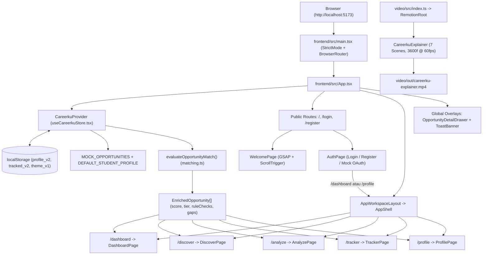

# Careerku — Complete Repository Code Flow (MOC)

> [!info] Cara Membuka di Obsidian
> 1. Buka **Obsidian** → pilih **Open folder as vault**.
> 2. Pilih folder `docs/obsidian-code-flow` di dalam repo `Careerku`.
> 3. Buka `[[Careerku Code Flow.canvas]]` untuk peta visual interaktif, atau tekan `Ctrl + G` (`Cmd + G` di macOS) untuk melihat **Graph View** antar catatan.

---

## Ringkasan Arsitektur Repositori

Repositori `Careerku` terdiri atas dua sub-proyek utama:

| Sub-proyek | Lokasi | Stack Utama | Fungsi |
| :--- | :--- | :--- | :--- |
| **Web App** | `frontend/` | React 19, TypeScript, Vite 8, Tailwind CSS v4, React Router v7, GSAP 3.15, Zod v4, Axios | Aplikasi web Careerku: landing page, auth UI, matching engine, AI skill gap, tracker, dan profile |
| **Explainer Video** | `video/` | Remotion 4.0, React 19, `@remotion/google-fonts`, TypeScript | Pipeline motion graphics 60 detik (`1920x1080 @ 60fps`) yang merender `video/out/careerku-explainer.mp4` |

---

## End-to-End Flow Diagram

---

## Peta Catatan (Index)

| No | Catatan | Fokus Utama |
| :-: | :--- | :--- |
| **Canvas** | `[[Careerku Code Flow.canvas]]` | Diagram node & alur data visual seluruh repo dalam format Obsidian Canvas |
| **01** | `[[01 - Bootstrap & Routing Flow]]` | Entry point `main.tsx`, struktur `<Routes>` di `App.tsx`, global drawer, dan query param `?opportunity=` |
| **02** | `[[02 - State Management & Data Flow]]` | `CareerkuContext`, `CareerkuProvider`, persistensi `localStorage`, derived `useMemo`, toast timer, dan `apiClient` |
| **03** | `[[03 - Matching Engine & Utilities Flow]]` | Algoritma rule-based `evaluateOpportunityMatch()`, pembobotan per kategori, formatter tanggal/label, dan model tipe TS |
| **04** | `[[04 - Public Pages Flow (Welcome & Auth)]]` | Alur animasi & section `WelcomePage` serta validasi, mock onboarding, dan redirect `AuthPage` |
| **05** | `[[05 - Workspace Shell & Navigation Flow]]` | `AppShell` (GSAP sliding pill nav, notif deadline, theme toggle, mobile nav), `OpportunityDetailDrawer`, dan `ToastBanner` |
| **06** | `[[06 - Workspace Pages Flow]]` | Detail state, aksi user, dan animasi pada `/dashboard`, `/discover`, `/analyze`, `/tracker`, dan `/profile` |
| **07** | `[[07 - UI Components, Styling & GSAP System]]` | Design tokens CSS (`Botanical Forest` & `Muted Earth`), komponen reusable (`CareerkuMatchGauge`, glyphs), dan aturan anti-konflik GSAP |
| **08** | `[[08 - Remotion Video Pipeline Flow]]` | Arsitektur sub-proyek `video/`, urutan 7 `<Sequence>`, scene components, dan skrip render Remotion |

---

## Catatan Terkait
- Lanjut ke entry point aplikasi: `[[01 - Bootstrap & Routing Flow]]`
- Lanjut ke otak data & state: `[[02 - State Management & Data Flow]]`
