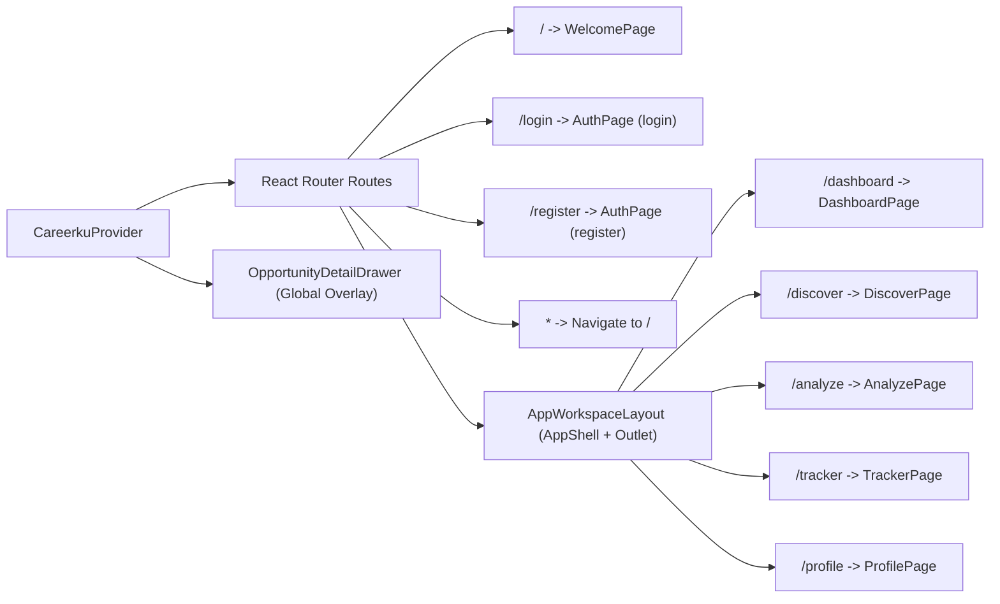

# 01 — Bootstrap & Routing Flow

Kembali ke `[[00 - Careerku Code Flow (MOC)]]`

## 1. Entry Point (`frontend/src/main.tsx`)

1. `main.tsx` me-render root DOM `#root` di `frontend/index.html`.
2. Membungkus `<App />` dengan `<StrictMode>` dan `<BrowserRouter>` dari `react-router-dom`.
3. Mengimpor `frontend/src/index.css` untuk memuat Tailwind CSS v4, custom dark variant, design tokens, dan keyframe CSS.

> [!warning] Implikasi `<StrictMode>` untuk Animasi
> Di mode development, React StrictMode menjalankan efek (`useLayoutEffect` / `useEffect`) dua kali saat mount. Karena itu seluruh efek GSAP di repo ini memakai `gsap.matchMedia()` + `mm.revert()` saat cleanup serta `prevValueRef` (bukan boolean `hasMountedRef`) agar animasi transisi tidak terpicu palsu saat mount kedua. Lihat detailnya di `[[07 - UI Components, Styling & GSAP System]]`.

---

## 2. Router Tree & Global Overlay (`frontend/src/App.tsx`)

Seluruh `<Routes>` dan `<OpportunityDetailDrawer />` dibungkus oleh `<CareerkuProvider>` (lihat `[[02 - State Management & Data Flow]]`), sehingga state profil, list peluang, dan drawer detail bertahan ketika berpindah halaman.

### Tabel Rute Lengkap

| Path | Komponen Target | Layout Wrapper | Akses & Tujuan |
| :--- | :--- | :--- | :--- |
| `/` | `WelcomePage` | Standalone | Landing page marketing & funnel onboarding (`[[04 - Public Pages Flow (Welcome & Auth)]]`) |
| `/login` | `AuthPage` (`initialMode="login"`) | Standalone | Form login & mock OAuth → arahkan ke `/dashboard` |
| `/register` | `AuthPage` (`initialMode="register"`) | Standalone | Form registrasi → simpan nama/email/univ → arahkan ke `/profile` |
| `/dashboard` | `DashboardPage` | `AppShell` | Ringkasan KPI, aplikasi berjalan, kalender deadline, checklist, AI insight (`[[06 - Workspace Pages Flow]]`) |
| `/discover` | `DiscoverPage` | `AppShell` | Katalog pencarian, filter kategori/High Match, & sortir peluang |
| `/analyze` | `AnalyzePage` | `AppShell` | Analisis rule check, skill gap (klik `+` langsung tambah skill), & portfolio sprint khusus kategori `internship` |
| `/tracker` | `TrackerPage` | `AppShell` | Workspace pipeline lamaran (`saved`, `preparing`, `applied`, `interview`), checklist dokumen, & draft CV/motivation letter |
| `/profile` | `ProfilePage` | `AppShell` | Edit IPK, semester, jurusan, daftar skill, pengalaman organisasi, & panel Live Matching Impact |
| `*` | `<Navigate to="/" replace />` | Standalone | Catch-all fallback ke landing page |

---

## 3. Cross-Page Deep Link via Query Parameter `?opportunity=<id>`

Selain navigasi langsung lewat tab navbar di `[[05 - Workspace Shell & Navigation Flow]]`, aplikasi memanfaatkan search params `?opportunity=<id>` untuk menjaga konteks item yang sedang dilihat user:

1. **Dari `OpportunityDetailDrawer` → `/analyze?opportunity=<id>`** (jika `category === 'internship'`), sehingga `AnalyzePage` langsung membuka internship tersebut.
2. **Dari `OpportunityDetailDrawer` → `/tracker?opportunity=<id>`** (jika `category !== 'internship'`), otomatis melacak item sebagai `preparing` bila belum dilacak lalu menyorotnya di `TrackerPage`.
3. **Dari `AnalyzePage` (`Start Prep & Track`) → `/tracker?opportunity=<id>`**, otomatis menambahkan internship ke tracker dengan status `preparing`.
4. **Dari `TrackerPage` (`Open AI Analysis`) → `/analyze?opportunity=<id>`**, melompat langsung ke analisis gap internship tersebut.
5. **Di dalam `AnalyzePage` & `TrackerPage`**, mengklik kartu di daftar kiri memanggil `setSearchParams({ opportunity: item.id })` sehingga pilihan aktif tersimpan di URL.

---

## Catatan Terkait
- Bagaimana state global dibagikan ke seluruh rute: `[[02 - State Management & Data Flow]]`
- Bagaimana navbar `AppShell` menganimasikan perpindahan rute: `[[05 - Workspace Shell & Navigation Flow]]`
