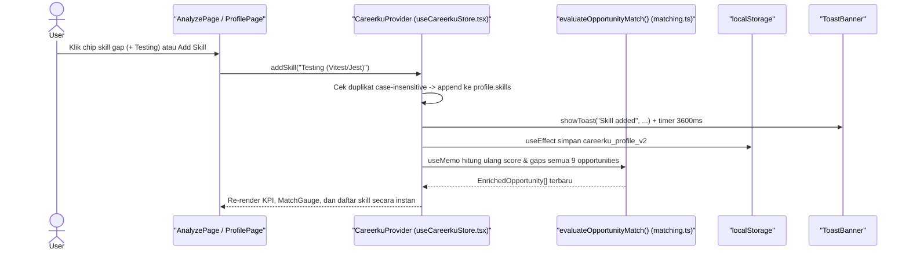

# 02 — State Management & Data Flow

Kembali ke `[[00 - Careerku Code Flow (MOC)]]`

Seluruh state aplikasi web dikelola terpusat oleh `CareerkuProvider` di `frontend/src/hooks/useCareerkuStore.tsx` dan diekspos melalui `useCareerku()` dari `frontend/src/hooks/careerkuContext.ts`.

---

## 1. Sumber Data & Persistensi (`localStorage`)

Saat pertama kali mount, `CareerkuProvider` membaca 3 key `localStorage` via helper `loadFromStorage<T>(key, fallback)`:

| Storage Key | State React | Default Fallback (`frontend/src/services/mockData.ts`) | Efek Persistensi (`useEffect`) |
| :--- | :--- | :--- | :--- |
| `careerku_profile_v2` | `profile: StudentProfile` | `DEFAULT_STUDENT_PROFILE` (Raka Pratama, ITB, Computer Science, Sem 5, IPK `3.62`, 9 skills, 2 experiences) | Menyimpan ulang JSON setiap kali `profile` berubah |
| `careerku_tracked_v2` | `trackedApplications: TrackedApplication[]` | `createInitialTrackedApplications()` (3 item awal: `opp-goto-fe` status `preparing`, `opp-beasiswa-bi` status `saved`, `opp-gemastik-rpl` status `applied`) | Menyimpan ulang JSON setiap kali `trackedApplications` berubah |
| `careerku_theme_v1` | `theme: ThemeMode` | `'light'` | Meng-toggle class `.dark` pada `document.documentElement` dan menyimpan ke `localStorage` |

Sementara itu, state **ephemeral** (tidak disimpan di `localStorage`) terdiri dari:
- `selectedOpportunityId: string | null` — mengontrol tampil/tidaknya `OpportunityDetailDrawer`.
- `toast: ToastMessage | null` — pesan notifikasi sementara (auto-dismiss setelah `3600ms` via `toastTimerRef`).

---

## 2. Reaktif Derived Data (`useMemo`)

Setiap kali `profile` berubah (edit IPK/semester/jurusan, tambah/hapus skill, atau registrasi baru), store otomatis menghitung ulang skor kecocokan seluruh `MOCK_OPPORTUNITIES` (9 listing terverifikasi) menggunakan `evaluateOpportunityMatch()` dari `[[03 - Matching Engine & Utilities Flow]]`:

- `opportunities: EnrichedOpportunity[]` = hasil pemetaan `MOCK_OPPORTUNITIES` + properti `match: MatchEvaluation`.
- `selectedOpportunity: EnrichedOpportunity | null` = item dari `opportunities` yang cocok dengan `selectedOpportunityId`.

---

## 3. Sequence Flow: Live Recalculation Saat Skill Ditambah

Contoh konkret bagaimana perubahan di satu halaman langsung memengaruhi seluruh aplikasi:

---

## 4. Katalog Aksi pada `CareerkuContextValue`

| Kategori | Method | Perilaku & Side Effects |
| :--- | :--- | :--- |
| **Profil & Skill** | `updateProfile(updater)` | Merge parsial ke `profile` + toast `"Profile updated"` |
| | `addSkill(skill)` | Trim string, abaikan jika kosong atau duplikat (case-insensitive) + toast `"Skill added"` |
| | `removeSkill(skill)` | Hapus skill (case-insensitive match) |
| | `addExperience(exp)` | Prepend experience baru dengan ID `exp-${Date.now()}` + toast |
| | `removeExperience(id)` | Filter experience berdasarkan `id` |
| **Application Tracker** | `getTrackedByOpportunityId(id)` | Lookup sinkron item `TrackedApplication` berdasarkan `opportunityId` |
| | `trackOpportunity(id, initialStatus)` | Prepend item baru ke `trackedApplications` memakai template `target.defaultDocuments` (`completed: false`) + toast |
| | `untrackOpportunity(id)` | Hapus item dari `trackedApplications` + toast info |
| | `updateApplicationStatus(id, status)` | Ubah `status` (`saved` / `preparing` / `applied` / `interview`) + perbarui `updatedAt` + toast |
| | `toggleDocumentItem(oppId, docId)` | Flip `completed` dokumen. **Auto-promotion rule:** jika status masih `'saved'` dan ada minimal 1 dokumen selesai (`anyCompleted`), status otomatis naik menjadi `'preparing'` |
| | `updateApplicationDrafts(id, payload)` | Simpan `notes`, `cvDraftNote`, atau `motivationLetterDraft` + perbarui `updatedAt` |
| **Drawer, Theme, Demo** | `openOpportunityDetail(id)` / `closeOpportunityDetail()` | Mengatur `selectedOpportunityId` |
| | `setTheme(mode)` | Mengubah `'light'` ↔ `'dark'` |
| | `showToast(...)` / `dismissToast()` | Menampilkan/menutup notifikasi (`3.6s` auto-dismiss) |
| | `resetDemoData()` | Mengembalikan `profile` & `trackedApplications` ke default seed data |

---

## 5. Kesiapan Integrasi Backend (`api.ts` & `env.ts`)

> [!info] Status Integrasi Saat Ini
> Saat ini seluruh runtime berjalan 100% client-side berbasis `MOCK_OPPORTUNITIES` dan `localStorage`. Namun layer HTTP & validasi environment sudah disiapkan untuk integrasi API backend di masa depan:

- `frontend/src/utils/env.ts`: Memvalidasi `import.meta.env` menggunakan Zod (`envSchema`), menyediakan default `VITE_API_BASE_URL = "http://localhost:5000/api"` dan `VITE_APP_NAME = "Careerku"`.
- `frontend/src/services/api.ts`: Membuat instance `apiClient = axios.create({ baseURL: env.VITE_API_BASE_URL, timeout: 15_000 })` beserta helper `parseApiResponse(schema, payload)` untuk runtime schema validation dengan Zod.

---

## Catatan Terkait
- Logika kalkulasi skor di balik `useMemo`: `[[03 - Matching Engine & Utilities Flow]]`
- Halaman yang mengonsumsi state ini: `[[06 - Workspace Pages Flow]]`
