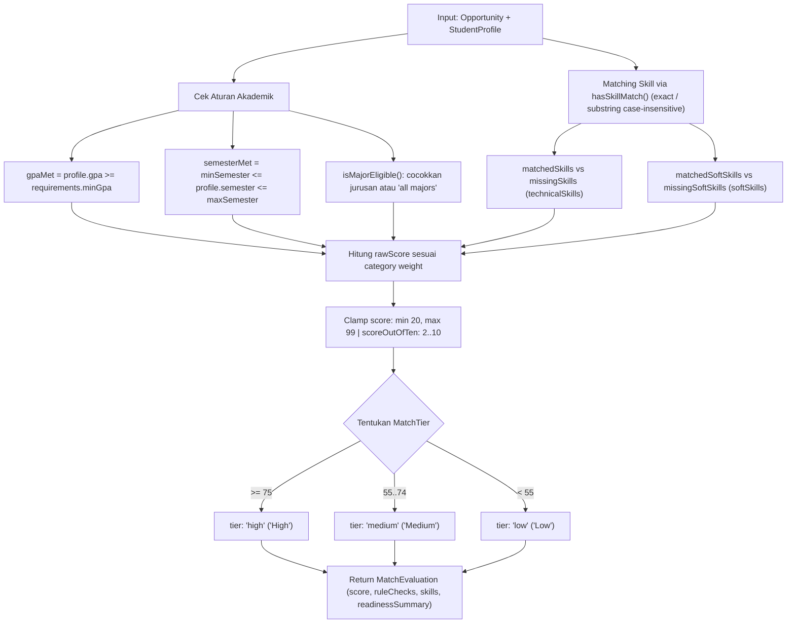
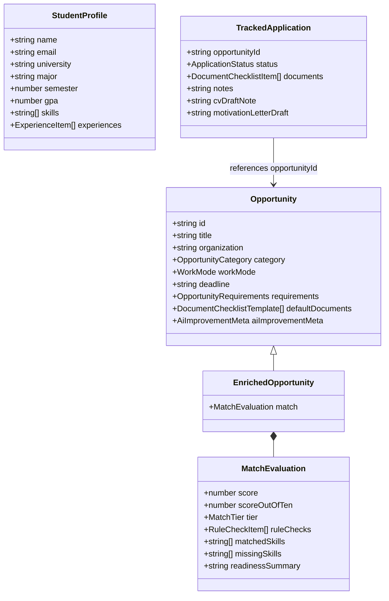

# 03 — Matching Engine & Utilities Flow

Kembali ke `[[00 - Careerku Code Flow (MOC)]]`

## 1. Rule-Based Matching Engine (`frontend/src/utils/matching.ts`)

Fungsi utama `evaluateOpportunityMatch(opportunity, profile)` membandingkan profil mahasiswa (`StudentProfile`) terhadap syarat resmi peluang (`OpportunityRequirements`) untuk menghasilkan `MatchEvaluation`.

### Alur Evaluasi

### Matriks Pembobotan per Kategori Peluang

| Kategori | GPA (`met` / `not met`) | Semester (`met` / `not met`) | Major (`met` / `not met`) | Technical Skills Ratio | Soft Skills Ratio | Total Maksimum |
| :--- | :---: | :---: | :---: | :---: | :---: | :---: |
| **`internship`** | `15` / `4` | `15` / `5` | `15` / `5` | `techRatio * 45` | `softRatio * 10` | `100` (di-clamp `99`) |
| **`scholarship`** | `35` / `10` | `20` / `6` | `15` / `6` | `techRatio * 10` | `softRatio * 20` | `100` (di-clamp `99`) |
| **`competition`** | `10` / `5` | `15` / `6` | `15` / `8` | `techRatio * 40` | `softRatio * 20` | `100` (di-clamp `99`) |

> [!tip] Insight Desain Pembobotan
> - **Internship** paling menekankan kesesuaian technical stack (`45` poin).
> - **Scholarship** paling menekankan IPK & semester aktif (`35 + 20 = 55` poin).
> - **Competition** menyeimbangkan technical skills (`40`) dengan soft skills (`20`).

---

## 2. Struktur Tipe Inti (`frontend/src/types/index.ts`)

---

## 3. Utilitas Pemformatan (`frontend/src/utils/format.ts`)

| Fungsi | Input | Output | Penggunaan |
| :--- | :--- | :--- | :--- |
| `formatDateID(isoDate)` | `'2026-12-15'` | `'15 December 2026'` | Kartu peluang, kalender, tracker, drawer |
| `formatVerifiedTimestamp(isoDateTime)` | ISO timestamp | `'Nov 23 • 09:15 WIB'` | Lencana verifikasi sumber di `OpportunityDetailDrawer` |
| `getDaysUntilDeadline(isoDate)` | ISO date string | Selisih hari (`Math.ceil`) | Countdown `D-xx` & filter `<= 14 hari` |
| `getCategoryLabel(category)` | `'internship' \| 'competition' \| 'scholarship'` | `'Internship' \| 'Competition' \| 'Scholarship'` | Badge & metadata card |
| `getStatusLabel(status)` | `'saved' \| 'preparing' \| 'applied' \| 'interview'` | `'Saved' \| 'Preparing Docs' \| 'Applied' \| 'In Review'` | Tracker status switcher & Dashboard |

---

## Catatan Terkait
- Siapa yang memanggil `evaluateOpportunityMatch`: `[[02 - State Management & Data Flow]]`
- Bagaimana skor `MatchEvaluation` divisualisasikan dengan C-logo gauge: `[[07 - UI Components, Styling & GSAP System]]`
