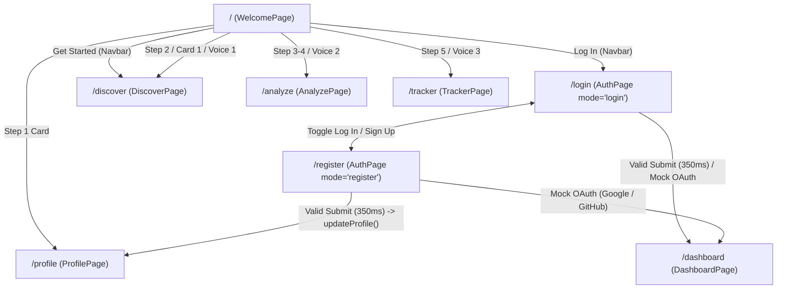

# 04 — Public Pages Flow (`WelcomePage` & `AuthPage`)

Kembali ke `[[00 - Careerku Code Flow (MOC)]]`

Dua halaman publik ini menjadi gerbang masuk sebelum pengguna masuk ke workspace utama di `[[05 - Workspace Shell & Navigation Flow]]`.

---

## 1. Alur User Funnel Halaman Publik

---

## 2. `WelcomePage` (`frontend/src/pages/WelcomePage.tsx`)

### Struktur Section & Interaktivitas
1. **Floating Top Navbar + Scroll Progress Bar:**
   - Listener scroll memperbarui state `isScrolled` (`window.scrollY > 36`) untuk beralih antara header transparan di atas foto hero dan header solid `backdrop-blur-md`.
   - Elemen `[data-gsap="scroll-progress"]` di bagian bawah navbar diisi secara real-time oleh GSAP `ScrollTrigger` (`scrub: 0.2`) sepanjang tinggi halaman.
2. **Section 1 — Full-Bleed Hero (`[data-gsap="hero-section"]`):**
   - Mount timeline (`heroTl`) memadukan zoom-out foto hero (`/images/hero-campus.jpg`), reveal social icons, animasi clip-line headline *"Match Smarter. Grow Faster."*, dan deskripsi.
   - Scroll parallax menggerakkan background (`yPercent: 12`) dan copy (`y: -32, opacity: 0.3`).
3. **Section 2 — About (`#about`):**
   - Eyebrow dan headline dua warna; bagian teks muted (`[data-gsap="about-muted"]`) di-scrub dari opacity `0.35` → `1`.
4. **Section 3 — Feature Bento Grid (`#features`):**
   - 4 kartu interaktif (`hoveredCard` state) yang berubah warna saat di-hover dan menavigasi ke `/discover`, `/analyze`, `/tracker`, dan `/profile`.
   - Counter angka (`[data-gsap-count]`) menghitung naik saat masuk viewport dengan `toggleActions: 'play none none reverse'`.
5. **Section 4 — How It Works (`#process`):**
   - Menggabungkan 5 kartu `PROCESS_STEPS` dan 3 foto (`PROCESS_PHOTOS`: `/images/step-01.jpg`, `step-02.jpg`, `step-04.jpg`).
   - Animasi baris atas (`process-row-1`) masuk dari kiri (`x: -48`) dan baris bawah (`process-row-2`) masuk dari kanan (`x: 48`) secara reversibel saat scroll, ditambah efek parallax foto (`process-photo-parallax`).
6. **Section 5 & 6 — Student Voices (`#voices`) & Footer (`[data-gsap="footer"]`):**
   - 3 kartu testimoni (`STUDENT_VOICES`) dengan highlight tema hover yang menavigasi langsung ke fitur relevan.

---

## 3. `AuthPage` (`frontend/src/pages/AuthPage.tsx`)

Satu komponen yang menangani mode `'login'` (`/login`) maupun `'register'` (`/register`) lewat prop `initialMode`.

### Alur Form & Validasi (`handleSubmit`)
1. **`validate()`** memeriksa:
   - Mode `register`: `fullName.trim().length >= 2`.
   - Semua mode: regex email valid (`/^[^\s@]+@[^\s@]+\.[^\s@]+$/`) dan `password.length >= 6`.
2. Jika valid, menyalakan spinner submit selama simulasi `350ms`:
   - **`register`:** memanggil `updateProfile({ name, email, university? })` di `[[02 - State Management & Data Flow]]`, menampilkan `showToast()`, lalu mengarahkan user ke `/profile` untuk mengisi IPK dan skill.
   - **`login`:** memperbarui `profile.email` jika berbeda, menampilkan welcome toast, lalu masuk ke `/dashboard`.
3. **Aksi Tambahan:**
   - **Mock OAuth (`handleOAuth`):** tombol `Google` dan `GitHub` langsung memunculkan toast login dan mengarahkan ke `/dashboard`.
   - **Forgot Password:** memunculkan toast info ke email aktif/target.

---

## Catatan Terkait
- Kemana user pergi setelah login: `[[05 - Workspace Shell & Navigation Flow]]` & `[[06 - Workspace Pages Flow]]`
- Bagaimana GSAP ScrollTrigger dikonfigurasi aman terhadap StrictMode: `[[07 - UI Components, Styling & GSAP System]]`
