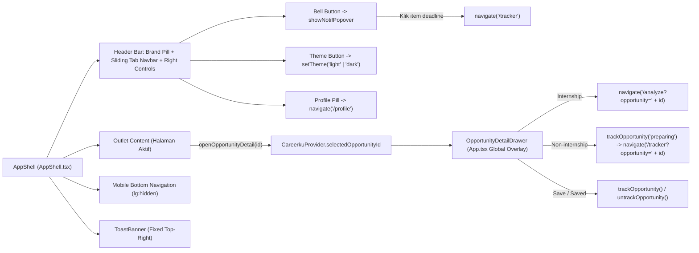

# 05 — Workspace Shell & Navigation Flow

Kembali ke `[[00 - Careerku Code Flow (MOC)]]`

Semua halaman di dalam subdomain workspace (`/dashboard`, `/discover`, `/analyze`, `/tracker`, `/profile`) berbagi bingkai navigasi yang sama dari `AppShell` ditambah dua global overlay (`OpportunityDetailDrawer` dan `ToastBanner`).

---

## 1. Alur Komponen Shell & Overlay

---

## 2. `AppShell` (`frontend/src/components/AppShell.tsx`)

### Daftar Tab Navigasi (`NAV_ITEMS`)
1. `/dashboard` — **Dashboard** (`Home`)
2. `/discover` — **Opportunities** (`Briefcase`)
3. `/analyze` — **AI Analysis** (`Sparkles`)
4. `/tracker` — **Tracker** (`ClipboardCheck`)
5. `/profile` — **Profile** (`UserRound`)

### Arsitektur Animasi GSAP Navbar (`AppShell.tsx`)
1. **Header Mount Entrance (`useLayoutEffect`, `[]`):**
   - Tiga kelompok flex header (`Brand Pill`, `<nav>`, `Right Controls`) ditandai `data-nav="group"` dan masuk dengan stagger (`y: -10, opacity: 0 → 0, 1`, `duration: 0.42`, `stagger: 0.06`, `clearProps: 'transform'`).
2. **Sliding Active Pill Indicator (`useLayoutEffect`, `[activeNavTo]` + `useEffect` resize/font sync):**
   - `` diposisikan absolut di belakang 5 `<NavLink>` (`relative z-10`).
   - Saat mount pertama (`!hasPositionedIndicatorRef.current`) atau resize/font settle (`syncIndicator`), langsung di-snap dengan `gsap.set(indicator, { x: offsetLeft, width: offsetWidth, opacity: 1 })`.
   - Saat berpindah rute di desktop, meluncur halus dengan `gsap.to(..., { x: offsetLeft, width: offsetWidth, duration: 0.36, ease: 'power3.out' })`.
   - Ikon tab aktif (desktop `[data-nav-icon]` dan mobile `[data-mobile-nav-icon]`) mendapat spring pop halus (`scale: 0.78 → 1`, `back.out(2)`).
3. **Deadline Reminders Popover (`[showNotifPopover]`):**
   - Mengambil `opportunities` yang ada di `trackedApplications`, menghitung `daysLeft = getDaysUntilDeadline(opp.deadline)`, mengurutkan terdekat, dan membatasi `.slice(0, 4)`.
   - Saat terbuka, container popover dianimasikan (`y: -8, scale: 0.97 → 0, 1`) diikuti stagger tiap `<li>`.
4. **Theme Toggle Spin (`[theme]`):**
   - Saat `prevThemeRef.current !== theme`, span pembungkus `<Moon />` / `<Sun />` berotasi halus (`rotate: -45, scale: 0.72 → 0, 1`).

---

## 3. Global Detail Drawer (`frontend/src/components/OpportunityDetailDrawer.tsx`)

Dipasang di level root `App.tsx` di dalam `<CareerkuProvider>`, sehingga bisa dipanggil dari halaman mana saja lewat `openOpportunityDetail(id)`:

- **Header:** Initials badge organisasi (`orgAccent`), kategori (`getCategoryLabel`), judul, tombol close (`closeOpportunityDetail`).
- **Body:**
  - *Profile Match Evaluation* (`MatchBadge` + `readinessSummary`).
  - Grid deadline (`D-xx`) & lokasi/workMode.
  - Kotak verifikasi resmi (`sourceName`, `formatVerifiedTimestamp(verifiedAt)`, tautan eksternal `Official Source`).
  - Deskripsi + `benefitLabel`.
  - Daftar *Academic Eligibility Check (Rule-Based)* (`ruleChecks` GPA, Active Semester, Major).
  - *Skill Qualifications* (`matchedSkills`, `missingSkills`, `matchedSoftSkills`, `missingSoftSkills`).
  - Preview *Required Documents* (`defaultDocuments`).
- **Footer Actions:**
  - Jika `category === 'internship'`: tombol **AI Skill Gap Analysis** → tutup drawer & buka `/analyze?opportunity=<id>`.
  - Jika bukan internship: tombol **Open Document Checklist** → auto-track `'preparing'` bila belum dilacak, tutup drawer & buka `/tracker?opportunity=<id>`.
  - Tombol kanan: toggle **Save to Tracker** / **Saved in Tracker**.

---

## 4. Notifikasi Toast (`frontend/src/components/ToastBanner.tsx`)

Menampilkan objek `toast` aktif dari `useCareerku()` secara fixed di kanan atas layar (`z-50`). Warna ikon otomatis mengikuti `toast.tone` (`--status-success` untuk `'success'`, `--accent-brand` untuk `'info'`), dan dapat ditutup manual lewat tombol `X` atau otomatis setelah `3.6` detik.

---

## Catatan Terkait
- Halaman-halaman yang di-render di dalam `<AppShell>`: `[[06 - Workspace Pages Flow]]`
- Routing yang membungkus `<AppShell>`: `[[01 - Bootstrap & Routing Flow]]`
