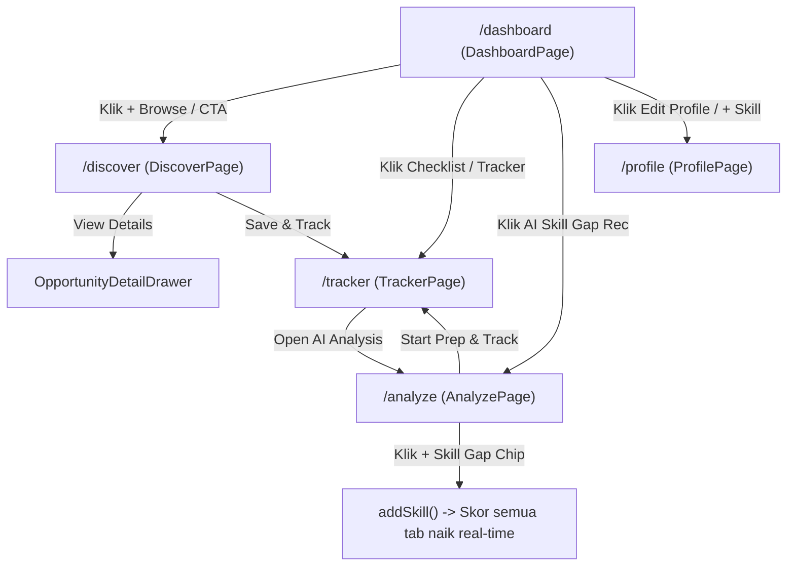

# 06 — Workspace Pages Flow

Kembali ke `[[00 - Careerku Code Flow (MOC)]]`

Seluruh 5 halaman workspace membaca state dari `[[02 - State Management & Data Flow]]` dan berjalan di dalam `[[05 - Workspace Shell & Navigation Flow]]`.

---

## 1. `/dashboard` (`DashboardPage.tsx`)
Berfungsi sebagai **pusat kendali utama** sekaligus acuan standar desain tab lain:
- **4 KPI Summary Cards:** High Matches, Average Match Score (`avgScore%` + IPK/skill summary), Documents Ready (`completedDocsCount / allTrackedDocs.length` + progress bar `doc-bar`), dan Upcoming Deadlines (`<= 14 hari`). Dilengkapi animasi GSAP roll-up angka pada metrik ringkasan saat mount.
- **Ongoing Applications:** Menampilkan daftar `trackedApplications` yang diperkaya skor & progres dokumen. Memiliki filter pill kategori (`all`, `internship`, `scholarship`, `competition`) dengan micro-animation saat filter berganti.
- **Interactive Deadline Calendar:** Kalender bulanan (`calendarMonth` dengan tombol prev/next) yang menandai tanggal deadline peluang dengan warna kategori (`--cat-internship`, `--cat-scholarship`, `--cat-competition`) dan bisa diklik untuk membuka `OpportunityDetailDrawer`.
- **Prioritized Document Checklist:** Mengurutkan `prioritizedChecklistDocs` (item yang belum selesai + deadline terdekat di atas, maksimal 5). Mengklik item memanggil `toggleDocumentItem()`.
- **Analytics, AI Recommendations & Profile Skills:** Progress bar kategori dengan `ScrollTrigger` (`once: true`), rekomendasi AI Skill Gap teratas, serta chip skill aktif.

---

## 2. `/discover` (`DiscoverPage.tsx`)
Katalog eksplorasi 9 peluang terverifikasi:
- **4 KPI Cards:** Verified Listings (reset filter), High Matches (toggle `onlyHighMatch`), Saved to Tracker (navigasi ke `/tracker`), Due Within 14 Days (ubah `sortMode` ke `'deadline'`).
- **Filter & Sort Pipeline (`useMemo`):**
  - Filter kategori (`activeTab`: `'all' | OpportunityCategory`).
  - Toggle `onlyHighMatch` (`opp.match.tier === 'high'`).
  - Pencarian live `searchQuery` pada `title`, `organization`, `summary`, dan `technicalSkills`.
  - Sort (`sortMode`): `'match'` (skor tertinggi) atau `'deadline'` (deadline terdekat).
- **GSAP Motion:** Timeline entrance saat mount, serta transisi kartu `[data-anim="opp-card"]` ketika `filterKey` (`activeTab|onlyHighMatch|sortMode`) berubah — `searchQuery` sengaja tidak masuk `filterKey` agar pengetikan tidak berkedip.

---

## 3. `/analyze` (`AnalyzePage.tsx`)
Analisis AI Skill Gap khusus kategori `internship`:
- **Sinkronisasi Role Aktif:** Memfilter `internships` terurut skor tertinggi dan memilih `activeInternship` dari `?opportunity=` atau item pertama.
- **4 KPI Cards:** Role Match Score, Technical Skills alignment (dengan `tech-bar`), Detected Skill Gaps, Portfolio Sprints.
- **Split Workspace:**
  - *Panel Kiri (`Select Internship`):* daftar kartu internship dengan `CareerkuMatchGauge` kecil.
  - *Panel Kanan:* header role + gauge ukuran `lg` + *Readiness & Qualification Score* bar (`readiness-bar`), 3 kartu `ruleChecks`, blok **Matched Skills** vs **Detected Skill Gaps**.
  - **Quick Skill Resolution:** mengklik chip gap bertanda `+` langsung memanggil `addSkill(skill)`, memicu penyimpanan `localStorage` dan kalkulasi ulang skor secara live.
  - **Lower Panels (`ScrollTrigger once: true`):** *Priority Learning Steps* (`prioritySkills`) dan *Recommended Portfolio Sprints* (`portfolioIdeas`).
- **Role Switch Animation:** pergantian `activeInternshipId` menganimasikan ulang panel analisis dan progress bar (`readiness-bar`, `tech-bar`).

---

## 4. `/tracker` (`TrackerPage.tsx`)
Workspace manajemen lamaran dan dokumen:
- **Data Enrichment:** Menggabungkan `trackedApplications` dengan detail `Opportunity`, menghitung `completedCount`, `totalDocs`, `progressPercent`, dan `daysLeft`, lalu mengurutkan berdasarkan deadline terdekat.
- **4 KPI Cards:** Total Tracked, Documents Ready (plus `kpi-doc-bar`), Applied/In Review, Due Within 14 Days.
- **Panel Kiri (`Tracked Applications`):** Filter pill status (`all`, `saved`, `preparing`, `applied` yang mencakup `applied` & `interview`). Mengklik kartu mengganti `?opportunity=`.
- **Panel Kanan (`Active Application Workspace`):**
  - Header detail + link `Official Portal` + `View Details` (buka drawer) + `Remove` (`untrackOpportunity`).
  - **Application Status Switcher:** `saved`, `preparing`, `applied`, `interview`.
  - **Sub-tabs (`prepView`):**
    1. `'checklist'`: Progress bar `checklist-bar`, daftar checkbox `toggleDocumentItem()` (dengan auto-promote `saved` → `preparing`), dan textarea *Personal Notes*.
    2. `'documents'`: *Recommended CV Highlights* + `cvDraftNote`, serta *Motivation Letter / Essay Prompts* + `motivationLetterDraft` (tersimpan otomatis via `updateApplicationDrafts()`).
  - **Micro-animations:** Efek transisi terpisah saat `activeTab`, `selectedId`, atau `prepView` berubah.

---

## 5. `/profile` (`ProfilePage.tsx`)
Manajemen profil mahasiswa dan pratinjau dampak langsung:
- **Kolom Kiri (`8 cols`):**
  1. **Academic Profile Form:** Edit `name`, `email`, `university`, `major`, `semester` (clamp `1..14`), `gpa` (clamp `0..4.00`) → `updateProfile()`.
  2. **Skills & Competencies:** Tambah skill kustom, hapus skill, atau klik cepat dari `SUGGESTED_SKILLS` yang belum dimiliki.
  3. **Organizations & Project Experience:** Tambah atau hapus `ExperienceItem` untuk mendukung konteks CV highlights.
- **Kolom Kanan Sticky (`4 cols`, `Live Matching Impact`):**
  - Menampilkan `Average Match Score`, jumlah `High Match`, dan `Total Skills` yang diperbarui seketika saat profil diubah.
  - Animasi masuk memakai `clearProps: 'transform'` agar CSS `sticky top-5` tetap bekerja normal.

---

## Catatan Terkait
- Aturan styling dan keamanan GSAP di semua halaman ini: `[[07 - UI Components, Styling & GSAP System]]`
- Sumber algoritma pencocokan yang dipakai semua tab: `[[03 - Matching Engine & Utilities Flow]]`
