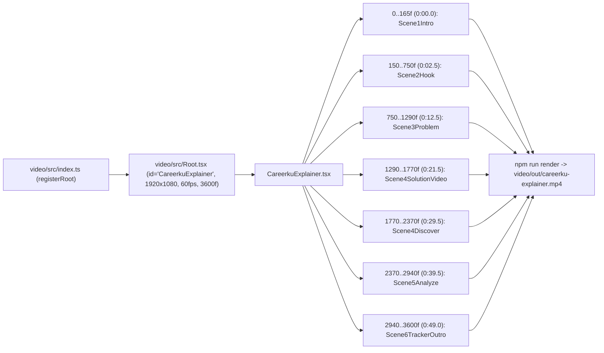

# 08 — Remotion Video Pipeline Flow (`video/`)

Kembali ke `[[00 - Careerku Code Flow (MOC)]]`

Sub-proyek terpisah di folder `video/` membangun video explainer **60 detik** (`3600 frames @ 60fps`, resolusi `1920×1080`) menggunakan **Remotion 4.0**.

---

## 1. Alur Pipeline & Komposisi Timeline

---

## 2. Daftar Sequence pada `CareerkuExplainer.tsx`

| Sequence | Frame (`from` / `duration`) | Rentang Waktu | Fokus Visual & Narasi |
| :---: | :--- | :--- | :--- |
| **1** | `from={0}`, `durationInFrames={165}` | `0:00.0 – 0:02.75` | `Scene1Intro` — Pembuka logo & identitas brand Careerku |
| **2** | `from={150}`, `durationInFrames={600}` | `0:02.5 – 0:12.5` | `Scene2Hook` — Animasi mahasiswa bingung (`ConfusedStudentsRig`) menuju hook masalah (overlap 15f dengan Scene 1) |
| **3** | `from={750}`, `durationInFrames={540}` | `0:12.5 – 0:21.5` | `Scene3Problem` — Chaos wall 16 kartu notifikasi & keraguan syarat kelayakan |
| **4** | `from={1290}`, `durationInFrames={480}` | `0:21.5 – 0:29.5` | `Scene4SolutionVideo` — Transisi solusi *"Meet Careerku"* dengan aset video `intro-student.mp4` |
| **5** | `from={1770}`, `durationInFrames={600}` | `0:29.5 – 0:39.5` | `Scene4Discover` — Demo UI `BrowserFrame` fitur AI Scraper & Verified Matching (`DiscoverPage`) |
| **6** | `from={2370}`, `durationInFrames={570}` | `0:39.5 – 0:49.0` | `Scene5Analyze` — Demo fitur Built-In AI Skill Gap Coach (`AnalyzePage`) |
| **7** | `from={2940}`, `durationInFrames={660}` | `0:49.0 – 1:00.0` | `Scene6TrackerOutro` — Demo Smart Document Tracker + outro wipe penutup |

> [!info] Catatan File Tambahan di `video/`
> Terdapat file `video/src/scenes/Scene3Reveal.tsx` di dalam folder scenes yang saat ini tidak di-import di `CareerkuExplainer.tsx` (digantikan oleh `Scene3Problem` & `Scene4SolutionVideo` pada timeline final).

---

## 3. Shared Modules, Aset & Perintah Render

- **Tema & Easing (`video/src/theme.ts`):** Memuat font `Poppins` via `@remotion/google-fonts/Poppins`, mendefinisikan `COLORS`, shadow presets, `EASE_OUT_EXPO`, dan `EASE_IN_OUT_SMOOTH`.
- **Komponen UI Video (`video/src/components/`):**
  - `BrowserFrame.tsx`: Mockup jendela browser desktop untuk menampilkan simulasi UI Careerku di Scene 5–7.
  - `CareerkuBrandMark.tsx`: Animasi brand mark SVG Careerku.
  - `ConfusedStudentsRig.tsx`: Rig karakter animasi mahasiswa untuk scene masalah.
- **Aset Media (`video/public/`):** `confused-students.jpg`, `hero-student.jpg`, `intro-student.mp4`.
- **Perintah NPM (`video/package.json`):**
  - `npm run studio`: Membuka Remotion Studio preview interaktif.
  - `npm run render`: Merender video final ke `video/out/careerku-explainer.mp4`.
  - `npm run still`: Mengekspor thumbnail still frame ke `video/out/preview.png`.

---

## Catatan Terkait
- Kembali ke peta utama repositori: `[[00 - Careerku Code Flow (MOC)]]`
- Bandingkan implementasi live web app dari scene Discover/Analyze/Tracker: `[[06 - Workspace Pages Flow]]`
